  
  
  
  

| 🔗 Going deeper | 🧱 Strengthening | 🎨 Always |
| :---: | :---: | :---: |
| Advanced blockchain engineering & smart-contract security | Backend architecture with Node, Express & PostgreSQL | Pairing strong visual design with clean, accessible code |

  

<table>
<tr><td align="center"><b>⚛️ Frontend</b></td><td>

</td></tr>
<tr><td align="center"><b>🎨 Styling & UI</b></td><td>

</td></tr>
<tr><td align="center"><b>🎞️ Motion</b></td><td>

</td></tr>
<tr><td align="center"><b>🧠 State & Data</b></td><td>

</td></tr>
<tr><td align="center"><b>🧱 Backend</b></td><td>

</td></tr>
<tr><td align="center"><b>⛓️ Web3</b></td><td>

</td></tr>
<tr><td align="center"><b>☁️ Ship & Tools</b></td><td>

</td></tr>
</table>

<i>Brand identities · social campaigns · UI mockups · illustrations · pitch decks</i>

**Open to frontend, Web3 and design-led product roles, freelance builds and collaborations.**

